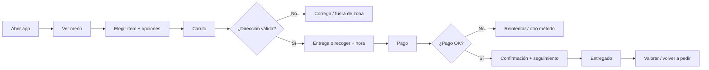

# 03 · Flujos y patrones de UX

> **Nota (etapa 2):** los patrones siguen siendo válidos, pero las pantallas de "menú de platos" y "panel de cocina" se reinterpretan como **catálogo de productos con elección de tienda** y **panel de tienda**; los estados límite incluyen ahora faltantes al alistar, sustitución de productos y ventana de frío. Ver `13-adaptacion-prolac.md`.

Se describen **patrones de interacción** observados en apps de reparto, no pantallas concretas de Uber Eats. La identidad visual debe ser propia (ver `09-diferenciacion.md`).

## 1. Journey principal del cliente

## 2. Pantallas del cliente (MVP)
1. **Inicio/Menú:** cabecera con estado del local (abierto/cerrado/saturado), categorías ancladas, buscador, tarjetas de plato.
2. **Detalle de plato:** foto, descripción, alérgenos, grupos de opciones con validación min/max, cantidad, botón "Añadir · precio total".
3. **Carrito:** líneas editables, resumen de precio **desglosado y sin sorpresas**, código promo, propina.
4. **Checkout:** modo (entrega/recoger), dirección, hora (ahora/programar), pago, botón único de confirmar.
5. **Seguimiento:** barra de estados, ETA como rango, resumen del pedido, contacto.
6. **Historial:** pedidos previos con "Volver a pedir".
7. **Perfil:** direcciones, métodos de pago, preferencias dietéticas, privacidad.

## 3. Patrones clave y por qué funcionan
| Patrón | Razón | Cómo aplicarlo |
|--------|-------|----------------|
| **Barra de carrito fija** | Mantiene el objetivo (comprar) siempre visible | Barra inferior con total y "Ver carrito" |
| **Precio total visible antes del pago** | Reduce abandono y desconfianza por cargos ocultos | Desglose: subtotal, entrega, impuestos, propina, descuento |
| **ETA como rango** | Evita promesas falsas | "30–40 min", recalculado con la carga de cocina |
| **Seguimiento por pasos** | Reduce ansiedad y consultas a soporte | 5 pasos: Recibido · Preparando · Listo · En camino · Entregado |
| **Reorden en un toque** | Mayor retención | Revalidar disponibilidad y precios al reordenar |
| **Invitado hasta el pago** | Menos fricción | Pedir cuenta solo para guardar datos |
| **Programar pedido** | Planificación y menos picos | Franjas de 15–30 min con cupo visible |
| **Estados vacíos y de error útiles** | Evitan callejones sin salida | "Estamos al límite, el próximo hueco es 20:15" |

## 4. Estados límite que hay que diseñar (suelen olvidarse)
- Local cerrado / saturado / pausado → permitir **programar** o avisar cuándo abre.
- Ítem agotado después de añadirlo al carrito → aviso y sustitución sugerida.
- Fuera de zona de reparto → ofrecer "recoger en local".
- Pago rechazado, 3-D Secure, tiempo agotado.
- Cambio de precio entre carrito y pago → mostrar diferencia y pedir confirmación.
- Sin conexión: carrito legible y reintento seguro (idempotencia, ver `06`).
- Cancelación: hasta cuándo es gratis; cómo se reembolsa.
- Pedido tarde: compensación automática opcional (cupón).

## 5. Panel de cocina (tablet)
- **Una sola pantalla**, columnas por estado: *Nuevos · Preparando · Listos · En reparto*.
- Alerta sonora persistente hasta aceptar.
- Botones grandes (uso con manos ocupadas), contraste alto, modo oscuro.
- Acciones rápidas: +5 min, pausar 15 min, marcar agotado, imprimir comanda.
- Indicador de **carga actual** (pedidos en preparación vs capacidad).

## 6. Accesibilidad y localización
Contraste AA, tamaños táctiles ≥ 44 px, soporte de lector de pantalla en carrito y checkout, textos y moneda localizados, alérgenos con texto además de icono.

## 7. Métricas de UX a instrumentar
Conversión menú→carrito→pago, abandono por paso, tiempo hasta el primer pedido, uso de "volver a pedir", tasa de errores de pago, contactos a soporte por pedido.
