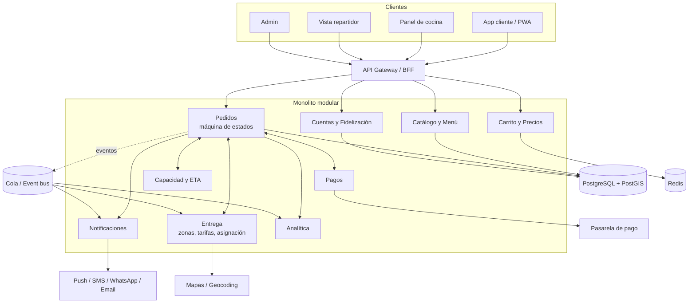

# 05 · Arquitectura: referencia (Uber) y propuesta

> **Nota (etapa 2):** la parte "Lo que se sabe de Uber" (§1) sigue vigente. La descomposición modular, el cálculo de ETA por carga de cocina y el "cuello de botella de cocina" (§2–§4) se escribieron para un restaurante y **se reemplazan** por los módulos, bucles y riesgos de `13-adaptacion-prolac.md` (inventario por ubicación y lote, capa anticorrupción con el POS/ERP, cadena de frío). El stack (§5) sigue siendo una buena base.

## 1. Lo que se sabe de Uber (y su fiabilidad)
| Tema | Dato | Nivel |
|------|------|-------|
| Estilo | Cientos de microservicios interdependientes (artículo de 2016) | A, antiguo |
| Despliegue | Docker sobre Mesos/Aurora (2016); HAProxy + Hyperbahn para enrutado; NGINX en el borde | A, antiguo |
| Geoespacial | **H3**: índice hexagonal jerárquico, 64 bits, resoluciones 0–15, usado en precios y despacho | A |
| Tiempos | Modelos separados: **preparación**, **viaje (ETA)** y **entrega (ETD)** | A/B |
| Datos | Combina históricos, casi tiempo real y tiempo real; plataforma ML (Michelangelo); bucle de reentrenamiento por escasez de etiquetas | B |
| Despacho | Pasó de *greedy* a **matching global** (todos los pedidos y repartidores a la vez) | B |
| Preparación | No observable directamente: el tiempo configurado por el comercio es la base; si la realidad es mayor, se despacha al repartidor demasiado pronto | A |

**Lectura (inferencia D):** la complejidad de Uber nace de operar en cientos de ciudades con tres poblaciones en tiempo real. Un negocio único con un local no tiene ese problema, por lo que copiar la arquitectura sería sobre-ingeniería.

## 2. Descomposición modular propuesta (monolito modular)


### Reglas de modularidad
- Cada módulo expone una **interfaz pública** (servicio + eventos) y es dueño de sus tablas; nadie hace joins entre módulos.
- Los módulos hablan por **eventos de dominio**: `OrderPlaced`, `PaymentAuthorized`, `OrderAccepted`, `OrderReady`, `OrderPickedUp`, `OrderDelivered`, `OrderCancelled`, `PaymentFailed`.
- La **máquina de estados del pedido** pertenece solo a `Pedidos`. Las demás apps solicitan transiciones; no escriben el estado.
- Extraíble a servicio cuando haya razón medida (p. ej. Notificaciones o Analítica).

## 3. Análisis sistémico
### Bucles de retroalimentación
| Bucle | Tipo | Dinámica | Mitigación |
|-------|------|----------|------------|
| ETA corto → más conversión → cocina saturada → ETA real sube → ETA mostrado pierde credibilidad | Refuerzo (negativo para el negocio) | Aparece con retraso (minutos–semanas) | ETA calculado con **carga actual**; pausa automática; cupos por franja |
| Pausar/limitar pedidos → cocina estable → mejor calidad → mejores reseñas → más demanda | Equilibrio → refuerzo | Retardo de reseñas | Aceptar menos pedidos de mejor calidad a propósito |
| Descuentos → pedidos por precio → dependencia del descuento | Refuerzo | Efecto lento, de 2º orden | Medir recompra sin cupón; descuentos con tope y vigencia |
| Repartidor tarda → comida fría → reembolso → menor margen → menos repartidores | Refuerzo | Semanas | Medir temperatura/tiempo en ruta; zonas más pequeñas |
| Más pedidos programados → picos suavizados | Equilibrio | Inmediato | Incentivar hueco menos cargado |

### Riesgos de segundo orden / emergentes
1. **Cuello de botella compartido oculto:** `Pedidos`, `Entrega` y `Cocina` parecen módulos independientes, pero dependen de la misma capacidad de cocina. Si el modelo de capacidad vive en un solo módulo (`Capacidad y ETA`) que todos consultan, se evita que cada uno prometa por su cuenta.
2. **Prometer por separado:** el carrito calcula un ETA, la cocina otro y el repartidor otro → estados contradictorios. Una **fuente única de verdad del ETA**.
3. **Picos sincronizados:** notificaciones masivas ("cupón de 12:00") generan un pico que satura cocina. Programar envíos escalonados o con cupo.
4. **Reintentos de pago + cliente impaciente:** pedidos duplicados. Idempotencia obligatoria.

### Tensión modularidad ↔ sistema (Ley de Conway)
Equipos separados (app cliente / cocina / reparto) tienden a duplicar lógica de estados y de tiempos. Contramedida: contrato de API versionado y **tests de contrato** entre apps y `Pedidos`; un responsable único del dominio de pedido.

## 4. ETA simple y honesto (sustituto de la ML de Uber)
```
ETA = espera_en_cola + prep_estimado + (entrega: tiempo_ruta + margen) | (recoger: 0)
espera_en_cola = Σ(prep de pedidos aceptados sin terminar) / cocineros_activos
prep_estimado  = percentil 70 del tiempo real de ese tipo de ítem (últimos 30 días)
```
- Mostrar **rango** (p50–p80). Recalcular al cambiar la carga.
- Registrar `prometido` vs `real` por pedido: es el dataset para un modelo ML posterior (V3).
- Ruta: API de mapas con tráfico, o tabla por zona al inicio.

## 5. Stack recomendado
| Capa | Recomendación | Alternativas | Razón |
|------|---------------|--------------|-------|
| Backend | Monolito modular en **TypeScript (NestJS)** o **Python (Django/FastAPI)** | Go, Kotlin/Spring | Productividad; módulos y eventos explícitos |
| BD | **PostgreSQL + PostGIS** | MySQL (sin geo avanzado) | Transacciones + polígonos de reparto |
| Caché/colas | **Redis** (carrito, locks, colas) | SQS/RabbitMQ | Simple al inicio |
| Tiempo real | **SSE/WebSocket** | Firebase | Estados del pedido y panel de cocina |
| App móvil | **Flutter** o **React Native** | Nativo | Una base para iOS/Android |
| Web | **PWA** (Next.js o similar) | App web simple | SEO local y pedido sin instalar |
| Panel cocina | Web responsive en tablet | App nativa | Rápido de iterar |
| Pagos | Pasarela tokenizada (Stripe, MercadoPago, Adyen… según país) | — | No tocar datos de tarjeta |
| Mapas | Google Maps / Mapbox / OSM + Nominatim | — | Geocoding y rutas |
| Infra | Contenedor + PaaS (Render, Fly, Cloud Run) | Kubernetes (no al inicio) | Coste y simplicidad |
| Observabilidad | Logs estructurados, métricas, alertas, Sentry | — | Detectar pedidos atascados |

## 6. Alternativa low-code para validar
Si el volumen esperado es bajo o la demanda es incierta: **Shopify/WooCommerce + plugin de entrega**, o Sharetribe/Firebase. Se pierde el control del ETA por capacidad y el panel de cocina a medida; se gana velocidad (días en lugar de semanas). Recomendación: validar 4–6 semanas con low-code si no hay demanda comprobada.

## 7. Ruta de escalado
1. Monolito + 1 instancia + réplica de lectura.
2. Extraer Notificaciones y Analítica.
3. Si se abren más locales: añadir entidad `Local` (el modelo debe incluirla desde el día 1 aunque haya uno), cocina por local y entonces sí descubrimiento.
4. Solo con volumen: ML de tiempos, matching de repartidores.

## 8. No funcionales
Disponibilidad objetivo 99.5 % en horas de servicio; p95 de API < 400 ms; RPO ≤ 5 min; todos los cambios de estado auditables; despliegues sin caída en horas pico (no desplegar de 12:00–14:30 y 19:00–22:00).
