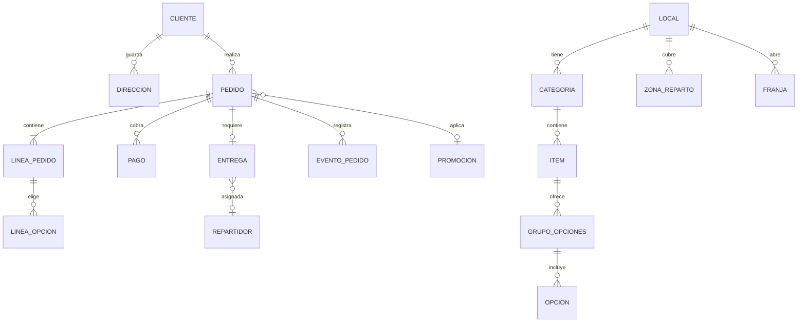
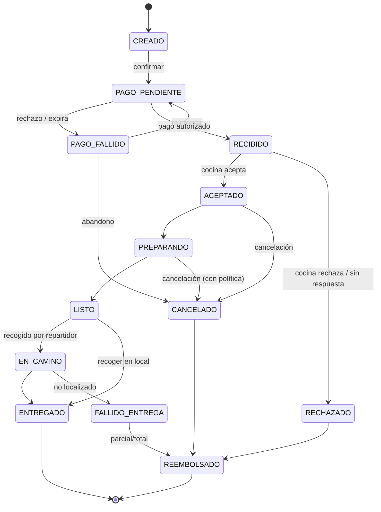

# 06 · Modelo de datos, estados y API

## 1. Entidades principales

Notas:
- `LOCAL` existe desde el inicio (aunque haya uno) para permitir crecer sin rehacer el modelo.
- **Congelar precios**: `LINEA_PEDIDO` guarda nombre y precio vigentes al comprar (snapshot), no referencias vivas.
- Dinero en **enteros (centavos) + moneda**, nunca float.
- `EVENTO_PEDIDO` es append-only (auditoría y base de métricas).
- `FRANJA` incluye `capacidad` y `reservados`.
- `ZONA_REPARTO` como polígono PostGIS con tarifa y mínimo.

## 2. Máquina de estados del pedido

Reglas:
- Solo `Pedidos` aplica transiciones; cada una valida actor y precondición (p. ej. solo cocina pasa `RECIBIDO→ACEPTADO`).
- **Timeouts:** `RECIBIDO` sin respuesta en N min → rechazo automático y reembolso/liberación de la autorización.
- Pago: **autorizar al crear, capturar al aceptar** (si el local rechaza, no hay cargo).
- Cada transición emite un evento y notifica al cliente.

## 3. API (REST + eventos). Resumen
Prefijo `/v1`. Autenticación por JWT corto + refresh; roles: `cliente`, `cocina`, `repartidor`, `admin`.

### Cliente
| Método | Ruta | Descripción |
|--------|------|-------------|
| GET | `/menu` | Menú vigente, disponibilidad y alérgenos |
| GET | `/slots?modo=entrega&direccion=` | Franjas disponibles con cupo |
| POST | `/delivery/quote` | Validar dirección contra zona, tarifa y mínimo |
| PUT | `/cart` | Crear/actualizar carrito (recalcula precios en servidor) |
| POST | `/orders` | Crear pedido. Cabecera **`Idempotency-Key`** obligatoria |
| POST | `/orders/{id}/pay` | Iniciar/confirmar pago (3-DS) |
| GET | `/orders/{id}` | Estado y ETA |
| GET | `/orders/{id}/stream` | SSE de cambios de estado |
| POST | `/orders/{id}/cancel` | Cancelación según política |
| POST | `/orders/{id}/reorder` | Clona a carrito revalidando disponibilidad |
| POST | `/orders/{id}/review` | Valoración |

### Cocina
| Método | Ruta | Descripción |
|--------|------|-------------|
| GET | `/kitchen/orders?estado=` (SSE) | Cola de pedidos |
| POST | `/kitchen/orders/{id}/accept` | Con `prep_minutos` |
| POST | `/kitchen/orders/{id}/reject` | Con motivo |
| POST | `/kitchen/orders/{id}/ready` | Pasa a `LISTO` |
| POST | `/kitchen/orders/{id}/delay` | +N minutos y notifica |
| POST | `/kitchen/pause` / `/resume` | Pausa de pedidos |
| PATCH | `/kitchen/items/{id}/availability` | Agotado hoy/hasta fecha |

### Repartidor / Admin
`GET /courier/deliveries`, `POST /courier/deliveries/{id}/picked-up|delivered`, `POST /courier/location`; admin: CRUD de menú, zonas, promos, reembolsos, reportes.

### Webhooks entrantes
`/webhooks/payments` (firma verificada, idempotente), `/webhooks/delivery-provider`.

## 4. Cálculo de precio (servidor es la fuente de verdad)
```
subtotal      = Σ (precio_item + Σ opciones) × cantidad
descuento     = regla(promo, subtotal, usuario)
tarifa_entrega= f(zona, distancia) − beneficio_club
impuestos     = según país (incluidos o añadidos)
propina       = elegida por el cliente
total         = subtotal − descuento + tarifa_entrega + impuestos + propina
```
El cliente nunca envía precios; envía ids y cantidades. El total se recalcula en cada paso.

## 5. Consideraciones de datos
- Índices: `pedido(estado, creado_en)`, `pedido(cliente_id, creado_en desc)`, GiST en `zona_reparto.geom`.
- Retención: datos personales según política (ver `08`); anonimizar a los N meses para analítica.
- Cola de eventos con **outbox** para no perder eventos si falla el commit.
