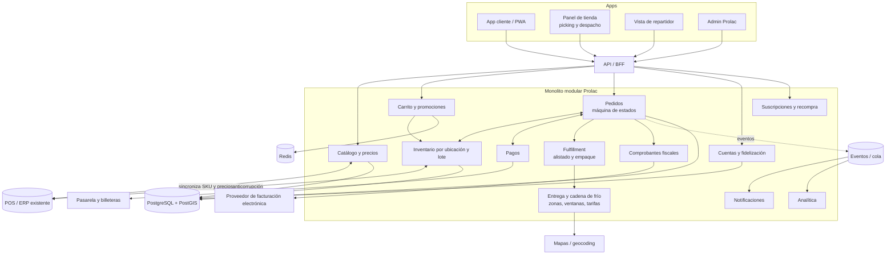
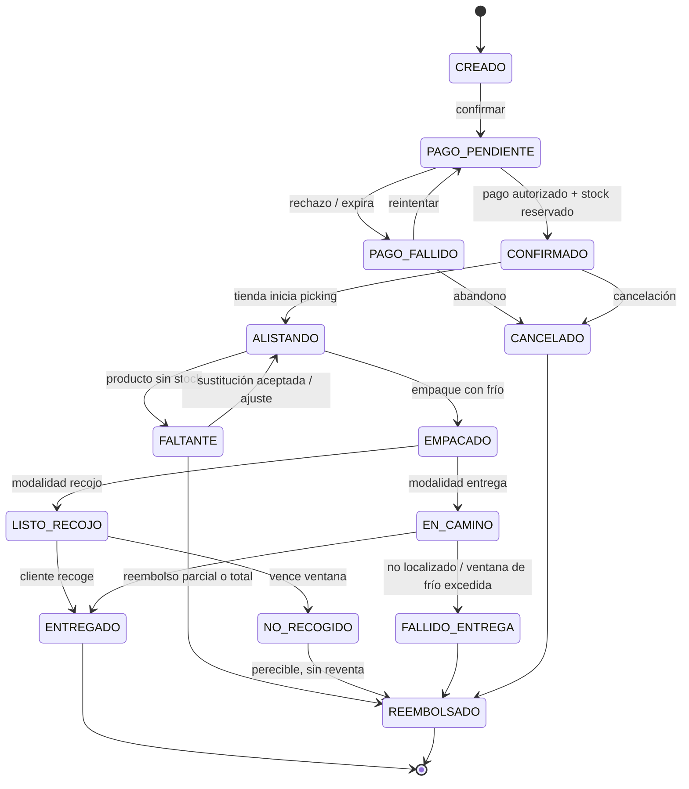

# 13 · Adaptación a Prolac (lácteos, multi-tienda, Perú)

> Este documento **prevalece** sobre `02`–`10` donde haya contradicción. Esos archivos se escribieron asumiendo un restaurante de comida preparada, antes de conocer el negocio real (`12-respuestas-descubrimiento.md`). Todo lo marcado como *hipótesis* se confirmará con las siguientes tandas del cuestionario.

## 1. Qué es Prolac (según lo declarado)
Fabricante-minorista de **lácteos**: 2 plantas de producción, 6 tiendas físicas en Trujillo, Chiclayo y Lima, +10 años de operación. El proyecto es un **nuevo canal de venta en línea** de producto propio, no un negocio nuevo.

Consecuencia clave: el modelo se parece más a un **e-commerce de supermercado/almacén de perecederos con recojo en tienda** que a un delivery de restaurante. No hay "tiempo de preparación" ni "cocina"; hay **stock, frescura, cadena de frío y reparto**.

## 2. Qué cambia respecto al dossier original
| Documento | Supuesto original | Versión Prolac |
|-----------|-------------------|----------------|
| `02` Funcionalidades | Panel de cocina, aceptar/rechazar, "Preparando" | **Panel de tienda**: alistar (*picking*), empacar, marcar faltantes/sustituciones, despachar o dejar listo para recojo |
| `03` UX | Menú de platos con opciones | **Catálogo de productos** con presentaciones, stock por tienda, filtros (sin lactosa, deslactosado, light, categoría), packs y recompra |
| `04` Negocio | Evitar comisión de marketplace | **Margen de fabricante + costo logístico de última milla con frío**; el ticket mínimo debe cubrir el reparto |
| `05` Arquitectura | Cuello de botella: cocina | Cuello de botella: **verdad del inventario** y **cadena de frío**; hay que integrarse con el POS/ERP existente |
| `06` Datos/API | `Local` único opcional; estados de cocina | `Ubicación` (planta/tienda) en el núcleo; **inventario por ubicación y lote**; estados de pedido de retail (ver §4) |
| `07` Integraciones | Pasarela genérica | Pasarelas y billeteras peruanas; facturación electrónica; POS/ERP del negocio |
| `08` Legal | Alérgenos de restaurante, normas genéricas | **Normativa peruana de alimentos y consumo** (ver §7) |
| `10` Roadmap | MVP de un local | **Piloto en una ciudad** (hipótesis: Trujillo), luego Chiclayo y Lima |

Lo que **se conserva** del análisis de Uber Eats: carrito persistente, checkout corto, estados visibles, **volver a pedir** (aún más relevante en compra recurrente de lácteos), pedido programado, suscripción, notificaciones, reseñas y la honestidad en tiempos y precios.

## 3. Módulos propuestos (monolito modular)

Reglas: cada módulo es dueño de sus tablas y habla por eventos. **Inventario** solo expone reservar / liberar / confirmar; la verdad contable del stock vive en el sistema del negocio hasta decidir otra cosa (ver §5).

## 4. Máquina de estados del pedido (retail con frío)

Reglas:
- **Reserva de stock con caducidad (TTL)** al iniciar el pago; se confirma al autorizarse el pago y se descuenta al alistar.
- Pago: autorizar al confirmar; capturar al **empacar** (así los faltantes no generan cobros a revertir). *Hipótesis; depende de la pasarela elegida.*
- Los estados `NO_RECOGIDO` y `FALLIDO_ENTREGA` son específicos de perecibles: el producto no siempre se puede reintegrar al stock.

## 5. Análisis sistémico específico
### Bucles de retroalimentación
| Bucle | Tipo | Dinámica | Mitigación |
|-------|------|----------|------------|
| Stock mostrado ≠ stock real (ventas en tienda y online a la vez, sincronización con retraso) → sobreventa → cancelaciones → desconfianza → menos pedidos | Refuerzo (negativo) | Aparece con retraso; se nota en picos | Reserva con TTL; **stock de seguridad exclusivo online**; sincronización por eventos; aviso "pocas unidades" |
| Ventana de entrega larga → pérdida de frío → reclamos y mermas → reembolsos → margen cae → se recorta el servicio | Refuerzo (negativo) | Semanas | Ventana máxima por zona, empaque térmico, despachar desde la tienda más cercana, zonas pequeñas al inicio |
| Compra recurrente (leche, yogur) → suscripciones → demanda previsible → producción planificada → menos merma → mejor precio | Refuerzo (positivo) | Meses | Impulsar suscripción y recompra; compartir pronóstico con planta |
| Reservar stock para online → menos producto en góndola → ventas perdidas en tienda | Equilibrio (conflicto interno) | Inmediato | Cupos por tienda y franja horaria; medir ventas totales, no solo online |

### Riesgos emergentes (segundo orden)
1. ~~Doble fuente de verdad del inventario.~~ **Resuelto por decisión del propietario (tanda 3):** la app **será** el POS y el sistema de inventario (hoy el conteo es manual al cierre del turno). El riesgo cambia de naturaleza: ya no es la divergencia entre dos sistemas, sino que **el POS propio debe ser fiable y rápido en el mostrador** (venta en línea y en mostrador compiten por la misma última unidad: bloqueo transaccional) y que el personal lo adopte. Se construye en la etapa 4B.
2. **Incentivos desalineados (Ley de Conway).** Si cada encargado de tienda se mide solo por ventas en mostrador, no priorizará alistar pedidos online. Atribuir la venta online a la tienda de origen.
3. **Éxito que rompe la tienda.** Un pico de pedidos online en la hora de más afluencia presencial satura al mismo personal. Franjas con cupo y alistado fuera del pico.
4. **Canibalización de canales.** Si hoy se vende a bodegas o a apps de reparto a otros precios, un precio online distinto crea conflicto de canal.

### Tensión modularidad ↔ sistema
`Inventario` se ve como módulo independiente, pero su dato real vive fuera (POS/ERP) y es el que más condiciona la experiencia. Se aísla con una **capa anticorrupción** y pruebas de contrato con el sistema del negocio.

## 6. Ventajas de Prolac frente al modelo Uber Eats (y qué explotar)
- **Producto propio y margen de fabricante**: no se comparte comisión de plataforma.
- **6 puntos físicos** = red de recojo y de origen de entrega ya instalada.
- **Compra recurrente**: suscripción y recompra con previsión de demanda hacia las plantas, algo que un marketplace no puede ofrecer.
- **Marca con +10 años** y clientela existente (activos que Uber Eats debe construir ciudad por ciudad).
- Lo que Uber Eats tiene y Prolac no (al inicio): red de repartidores a demanda y tráfico propio. Se compensa con recojo en tienda y reparto acotado.

## 7. Cumplimiento en Perú: lista de verificación (fuentes de confianza media-baja; **confirmar con abogado/contador y con el texto vigente**)
| Tema | Qué se encontró | Estado |
|------|-----------------|--------|
| Libro de Reclamaciones virtual | La **Ley 32495** (nov. 2025) lo extiende a plataformas de e-commerce (web y apps); Indecopi ofrece una herramienta gratuita. Reglamento pendiente según la fuente. [Perú Retail](https://www.peru-retail.com/congreso-aprueba-que-el-libro-de-reclamaciones-sea-obligatorio-en-tiendas-online-y-apps-de-compras/), [kom.pe](https://kom.pe/ley-32495-como-afecta-el-nuevo-libro-de-reclamaciones-al-ecommerce/) | Verificar vigencia y reglamento |
| Registro sanitario | DIGESA regula la venta de alimentos también por internet; registro por producto y fabricante, vigencia de 5 años según una guía comercial. [kom.pe](https://kom.pe/tienda-virtual-alimentos-bebidas-lima-peru/) | Confirmar que cada SKU en línea tenga registro vigente |
| Reglamento de lácteos | D.S. 007-2017-MINAGRI. [LP Derecho](https://lpderecho.pe/aprueban-reglamento-leche-productos-lacteos/) | Revisar requisitos de conservación y transporte |
| Cadena de frío en venta online | No se encontró texto específico | **Sin confirmar** |
| Comprobantes electrónicos (boleta/factura) | No se encontró fuente | **Sin confirmar**: consultar al contador |
| Protección de datos personales (Ley 29733) | No investigado | **Pendiente** |
| Pagos | Niubiz, Izipay y Culqi como adquirentes; Yape y Plin como billeteras de mayor crecimiento; comisiones muy variables entre fuentes. [Guía de Software](https://www.guiadesoftware.com/blog/mejor-pasarela-pago-peru), [kom.pe](https://kom.pe/pasarelas-pago-tiendas-online-peru-comparativa/), [Andina](https://andina.pe/ingles/noticia-billeteras-electronicas-yape-y-plin-son-los-medios-pago-mayor-crecimiento-986707.aspx) | Cotizar con 2–3 proveedores |
| Competencia de reparto | PedidosYa operaba en Trujillo y Chiclayo (dato de 2022). [DPL News](https://dplnews.com/peru-pedidosya-apunta-a-abrir-operaciones-en-hasta-10-ciudades-peruanas-en-2022) | Cobertura actual sin verificar |

## 8. Hipótesis de MVP (actualizado tras la tanda 3)
1. **Piloto en Trujillo** (confirmado). Tiendas por definir; las del esqueleto son ficticias.
2. Catálogo reducido de los productos más vendidos y de mejor conservación.
3. **Recojo en tienda** y **entrega a domicilio** hasta **4 km** de la tienda más cercana, en **cooler**, con meta de **20 minutos desde que sale el repartidor** (semáforo, no límite) y **2 repartidores propios**. **Nunca se rechaza una entrega** por carga ni por monto: se muestra un **tiempo estimado** que crece con la demora, y no hay pedido mínimo (se suma el costo de reparto).
4. Pago con tarjeta y Yape/Plin; efectivo contra entrega por decidir.
5. Panel de tienda para alistar, pesar, empacar y despachar; vista del repartidor con cuenta regresiva; Libro de Reclamaciones visible; comprobante electrónico.
6. **POS de mostrador e inventario en tiempo real** (etapa 4B): ventas de mostrador, recepción de los camiones de los miércoles y domingos, apertura y cierre de turno.
7. Meta de aprendizaje: pedidos/día, % de faltantes, **% de entregas demoradas (más de 20 min)** y **tiempo prometido vs. real** para ajustar el estimado, recompra a 30 días.
8. Después: Chiclayo y Lima, **pedidos por mayor desde la planta más cercana**, suscripciones.

## 9. Decisiones del cuestionario: estado
| Decisión | Estado |
|----------|--------|
| Ciudad piloto | ✅ Trujillo |
| Sistema de inventario/POS | ✅ La app lo será (etapa 4B) |
| Origen de cada pedido | ✅ Menor: tienda más cercana · Mayor: planta más cercana (fuera del piloto) |
| Reparto | ✅ 2 repartidores propios al inicio |
| Cobertura | ✅ Radio de 4 km (línea recta) |
| Tiempo de reparto | ✅ Meta de 20 min desde que sale el repartidor, en cooler; extensible, sin límite crítico; se avisa el tiempo aproximado |
| Rechazo de entregas / pedido mínimo | ✅ Ninguno: siempre se acepta dentro de 4 km y se suma el costo de reparto |
| Tiendas, direcciones y horarios | ⏳ Pendiente (pregunta 46) |
| Pasarela y facturación | ⏳ Pendiente |
| Presupuesto y fecha | ⏳ Pendiente |
| Catálogo inicial, precios y fotos | ⏳ Pendiente (acabados) |
