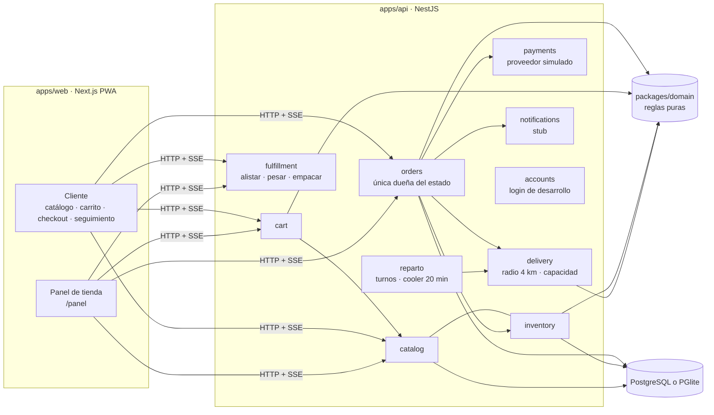

# 14 · Arquitectura del esqueleto (etapa 3)

Qué se construyó, cómo se conecta y qué falta. Las decisiones de fondo vienen de `13-adaptacion-prolac.md`; los datos del negocio, de `12-respuestas-descubrimiento.md`.

## 1. Mapa

Reglas que el código hace cumplir:
- **Un solo dueño del estado:** solo `OrdersService.transition` cambia el estado; valida con `applyEvent` del dominio (actor, estado, condición) y registra cada cambio en `evento_pedido` (solo se inserta).
- **El cliente no fija precios:** envía ids y cantidades o gramos; el servidor calcula. Los campos extra se rechazan.
- **Cobro por peso:** se autoriza con margen (10 %); al empacar se captura el total real; si el peso real excede lo autorizado se rechaza.
- **Idempotencia:** `POST /v1/pedidos` exige `Idempotency-Key`; repetirla devuelve el mismo pedido.
- **Stock:** reserva con caducidad (10 min) mientras se paga; vida útil mínima restante y vencimiento más próximo primero (FEFO) cuando hay lotes; el consumo real ocurre al empacar.
- **Reembolso automático** tras cancelar o abandonar un pago fallido.
- **Permisos:** 403 si el rol no puede ejecutar el evento; un cliente nunca ve pedidos ajenos (responde "no existe").

## 2. Datos de la tanda 2 reflejados
| Dato | Dónde |
|------|-------|
| Productos por peso y envasados | `sku.modalidad` (`PACK`/`PESO`), `linea_pedido.gramos_*`, `packages/domain/src/pricing.ts` |
| Vida corta, 2–4 °C | `lote.vence_en`, `producto.temp_*`, `domain/shelf-life.ts`, ventana de frío en `entrega.limite_frio_en` |
| Sin códigos de barras | `sku.codigo` interno; `codigo_barras` opcional |
| Stock casi perenne | `disponibilidad_tienda.cantidad` es opcional (nulo = no se controla) |
| Sin combos | no se construyeron |
| Registro sanitario y etiquetado | `producto.registro_sanitario` y `producto.etiquetado`, visibles en la ficha |
| Sin fotos | `ProductImage` muestra un marcador; `producto.imagen_url` queda listo |
| ~200 SKU | importador CSV (`pnpm import:catalog`) |

## 3. Patrones de Uber Eats aplicados (identidad propia)
Cabecera con tienda y conmutador Recojo/Entrega, barra inferior, chips de categoría, carruseles de tarjetas, ficha con selector y botón "Añadir · precio", barra de carrito fija, checkout corto, seguimiento por pasos, "volver a pedir" y panel por columnas de estado. Colores, tipografía del sistema, íconos y textos son provisionales y propios (`packages/ui-tokens`).

## 4. Cambios respecto al plan aprobado
- **Drizzle + PGlite en lugar de Prisma:** Drizzle no descarga motores binarios y PGlite permite arrancar sin instalar nada. Es lo previsto en el plan como mitigación.
- **Panel de tienda** como grupo de rutas `/panel` de la misma app web (no una app aparte).
- **Redis** no se incluyó: el código no lo usa todavía; se retiró de `docker-compose.yml`.
- ~~Zonas de reparto como polígono JSON~~ → reemplazado en la etapa 4A por un **radio por tienda** (ver §7).
- **Cancelación por la tienda** (`cancelar`) se añadió al panel porque la máquina de estados ya la permitía.

## 5. Lo que es provisional
| Pieza | Estado | Se reemplaza por |
|-------|--------|------------------|
| Autenticación | Código fijo `123456` (se bloquea en producción) | Código por SMS/WhatsApp y sesiones reales |
| Pagos | `SimulatedPaymentProvider` | Niubiz / Izipay / Culqi, Yape y Plin, tras cotizar |
| Notificaciones | Solo se registran | Push, WhatsApp, SMS |
| Catálogo, tiendas, zona, precios | Ficticios `[DEMO]` | Datos reales (CSV y panel) |
| Direcciones | Ubicación de prueba, sin mapa | Autocompletado y mapa |
| Facturación | No existe | Comprobantes electrónicos con proveedor autorizado (confirmar con el contador) |
| Libro de Reclamaciones | No existe | Enlace visible y herramienta de Indecopi (verificar reglamento) |
| Reparto | Vista de repartidor y asignación automática entre 2 repartidores (etapa 4A) | Proveedor externo u otros repartidores, si se decide |
| Distancia | Línea recta (haversine) hasta 4 km | Distancia y tiempo reales por calle con un servicio de mapas |
| Inventario | Disponibilidad y lotes propios; cantidad opcional | **POS de mostrador, recepción de camiones y turnos (etapa 4B)**: la app será el sistema de inventario |
| OpenAPI | Solo lista rutas, sin esquemas de cuerpo | Esquemas generados |
| Reservas vencidas | Se ignoran al calcular disponibilidad; `releaseExpired` existe pero nada lo programa | Tarea periódica |
| Pedidos con pago fallido | Quedan abiertos hasta que el cliente cancela | Cancelación automática por tiempo |

## 6. Verificación realizada
- Dominio: 35 pruebas.
- API: 27 pruebas (importador, flujo completo, pesaje, faltantes, idempotencia, pago rechazado, cancelación, permisos, zonas, vida útil, caducidad de reserva y SSE). Los 23 e2e de pedidos también pasan contra **PostgreSQL 17 real** (instancia temporal; no había Docker).
- Cliente y panel: recorrido real en Chromium (390 px y 1024 px) con capturas revisadas. La revisión encontró y corrigió un desborde del conmutador Recojo/Entrega en móvil.
- `pnpm dev` arranca API y web sin Docker con datos de muestra.
- No verificado: la PWA instalada en un teléfono real, pruebas de carga, accesibilidad con lector de pantalla y el comportamiento sin conexión.

## 7. Etapa 4A · Reparto y frío (tanda 3)
**Reglas nuevas** (ver `12` tanda 3):
- **Cobertura por radio:** cada tienda cubre hasta **4 km** en línea recta (`ubicacion.radio_entrega_km`, tarifa y mínimos por tienda). Entre las tiendas que cubren una dirección se elige **la más cercana** automáticamente (`packages/domain/src/delivery.ts`). Si ninguna llega, se informa a qué distancia está la más cercana.
- **Cooler y 20 minutos:** el reloj **arranca cuando el repartidor sale** (`despachar`), no al empacar. Se guarda `entrega.limite_frio_en`; entregar tarde se **permite pero se registra** (`entrega.fuera_de_frio` y el evento).
- **Capacidad:** con 2 repartidores y máximo 2 pedidos de entrega cada uno (supuesto), el pedido de entrega 5 se rechaza con `REPARTO_SATURADO`; sin repartidores de turno, `SIN_REPARTIDORES`. En ambos casos la app ofrece **recojo**.
- **Asignación:** al salir, el pedido va al repartidor de turno **con menos pedidos en ruta** (desempate por quien lleva más tiempo libre y, al final, por id). Si sale el propio repartidor, queda asignado a él.
- **Pedidos por mayor / plantas:** fuera del piloto; las plantas existen como ubicaciones pero no aparecen en la app.

**Piezas nuevas:** `GET /v1/reparto/pedidos` y `POST /v1/reparto/turno` (vista del repartidor), `GET /v1/tienda/reparto` (resumen del panel), `POST /v1/entrega/resolver` (qué tienda atiende una dirección), tabla `repartidor_turno`, migraciones `0001`/`0002`, pantalla `/reparto` y cuenta regresiva (`ColdTimer`) para el repartidor, la tienda y el cliente.

**Verificación:** dominio 47 pruebas; API 38 pruebas (34 e2e también contra PostgreSQL 17 real); recorrido en Chromium con entrega a domicilio, dirección fuera de cobertura y cuenta regresiva (capturas 10–16).

**Limitaciones de 4A:** la distancia en línea recta subestima la de calle; los repartidores pertenecen a una tienda (en el piloto, Las Casuarinas); una carrera entre dos pedidos simultáneos puede dejar pasar uno más de lo que indica la capacidad (no hay bloqueo sobre el conteo de capacidad); `maxPedidosPorRepartidor = 2` es un supuesto; no hay compensación automática por entrega tardía (solo se registra y se avisa).

